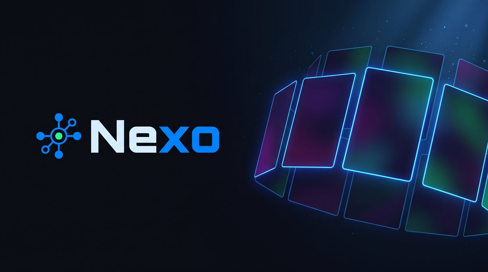
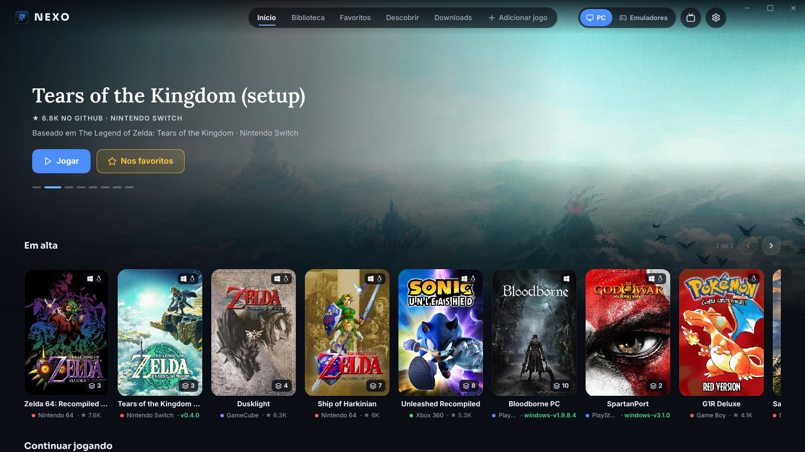
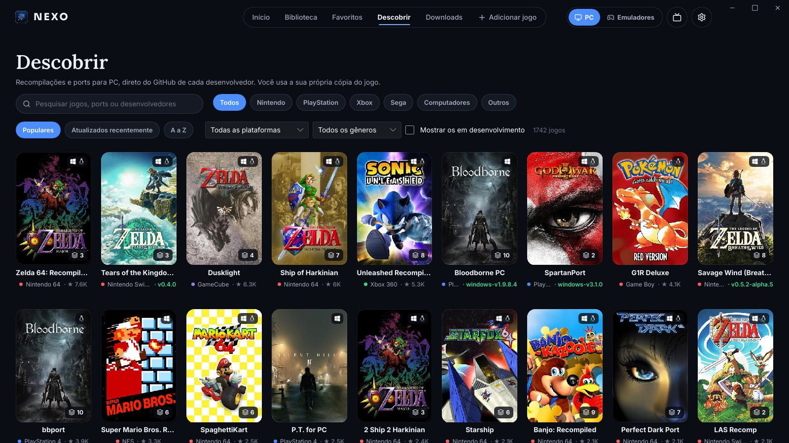
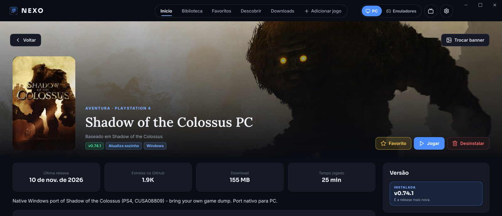
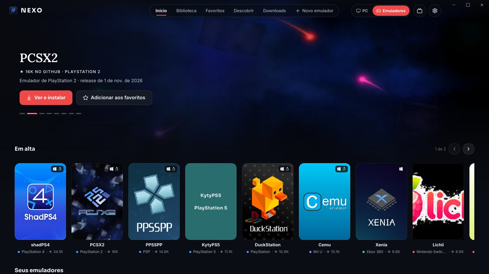
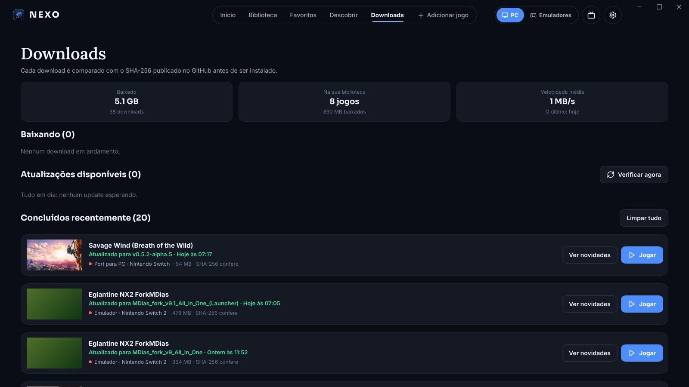
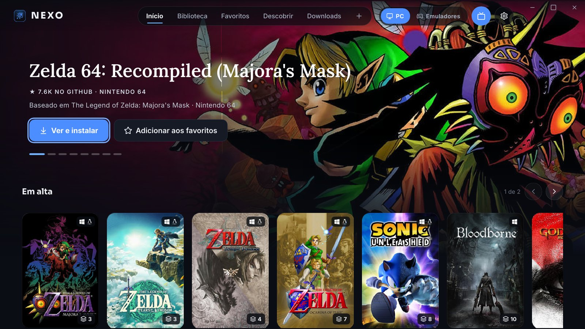

<p align="center">
  
</p>

<p align="center">
  <b>The community's recomps, ports and emulators in one place.</b><br>
  Discover, install, update and play — straight from each developer's GitHub.
</p>

<p align="center">
  <a href="https://github.com/nexolauncher-glitch/nexo/releases/latest"></a>
  
  <a href="LICENSE"></a>
</p>

<p align="center"><a href="README.md">Português</a> · <b>English</b></p>

---



## What is Nexo

Over the last few years the community has turned classic console games into programs that run
**natively on PC**: static recompilations (*recomps*) and *ports* — Zelda 64, Sonic Unleashed,
Bloodborne, Tears of the Kingdom and many more. Each one lives in its own repository, with its own way
to install, update and set up the game.

**Nexo** brings all of that together in a lightweight launcher for Windows and Linux:

- a **catalog of 1,700+ projects** and 20+ emulators, with covers, banners and stars;
- **one-click install and updates**, always downloaded from the official release of each project;
- **SHA-256 checks** on every file, and it **never deletes your saves**;
- a **TV mode** with full controller support, for the couch or the Steam Deck.

> Nexo **does not ship games, keys, firmware or BIOS files**. Catalog projects ask for your own copy
> of the game; Nexo only downloads what the developer published and keeps it organized for you.

## Features

**Discover and organize**
- Two universes: **PC** (recomps and ports) and **Emulators**, each with its own Home, Library,
  Favorites and Discover.
- Search, filters by console, platform and genre, sorting by popular, recent or A–Z.
- Automatic covers and banners from [SteamGridDB](https://www.steamgriddb.com), with no setup; or your own.
- Add any project from a GitHub, Codeberg or other Forgejo/Gitea link.

**Install and update safely**
- Picks the right file for your system automatically; you can choose another.
- Resumable downloads with the published SHA-256 checked.
- Each version lives in its own folder. The previous one stays until you decide to delete it, so you
  can roll back or **pin** a version.
- Your saves and files are carried to the new version; anything an update would overwrite is backed up
  first.
- **Automatic recipes** for projects that need setup: Nexo runs the setup, builds shaders and can even
  **assemble the game from your Switch NSP/NSZ files**, with no external tools.

**Play**
- Play directly or through the project's own launcher, with play time tracked.
- **Automatic save backups** (before every update and on uninstall), with restore.
- **Add to Steam** with the game's cover: the shortcut opens through Nexo, keeping version, Proton and
  play time.
- On Linux, Windows-only games run through **Proton, umu-run or Wine**.

**Look and comfort**
- Dark or light theme, Portuguese or English.
- **TV mode**: fullscreen, larger UI and complete controller navigation. Turns on by itself in Steam
  Deck's Game Mode, or with one click on the TV button.
- Nexo updates itself from this repository's releases, always asking first, and only accepts
  versions signed by Nexo.

## Screenshots

| Discover | Game page |
|---|---|
|  |  |
| **Emulators** | **Downloads** |
|  |  |

**TV mode**



## Install

Get the latest version from **[Releases](https://github.com/nexolauncher-glitch/nexo/releases/latest)**.

### Windows 10/11 (64-bit)
1. Download `nexo-…-windows-x64.zip` and extract it to a folder of yours (e.g. `Documents\Nexo`).
2. Run `nexo.exe`.
3. The first time, Windows may show **"Windows protected your PC"**, because Nexo does not have a paid
   code-signing certificate yet. Click **More info → Run anyway**.

### Linux (x64)
1. Download `nexo-…-linux-x64.tar.gz` and extract it:
   ```bash
   mkdir -p ~/Nexo && tar -xzf nexo-*-linux-x64.tar.gz -C ~/Nexo
   ```
2. Run `~/Nexo/nexo`.
3. For games that only have a Windows build, install **Proton** (through Steam) or **umu-launcher**.

On the Steam Deck and other systems with Steam's Game Mode, use **Settings → Add Nexo to Steam** to open
it in TV mode straight from Game Mode.

### Updates
Nexo checks for new versions when it opens and every few hours. When one is out, it shows what's new and
asks before updating. The download comes from this repository's releases; Nexo checks the version's signature and the
package's SHA-256 before replacing any file.

## FAQ

**Is Nexo piracy?** No. It doesn't host or download commercial games. Catalog projects are free
programs published by their authors on GitHub, and each one asks for game files you already own.

**Where are the games stored?** In the folder you pick under **Settings → Folders** (by default
`Nexo/Jogos` in your home folder). Each game gets one folder per version.

**Does uninstalling a game delete my saves?** No. Nexo only deletes files it installed itself, and shows
you what will go first.

**I found a project that isn't in the catalog.** Use **Add game** with the repository link, or open an
*issue* here so it joins everyone's catalog.

## Command line

Nexo ships with `nexo-cli` for scripts and servers: `nexo-cli ajuda` lists everything. The main commands
are `lista`, `instalar <id>`, `verificar`, `atualizar`, `jogar <id>` and `remover <id>`.

## Credits and license

- Catalog built from Nexo's own curation, [recomplauncher.com](https://recomplauncher.com) and
  [recomphub.com](https://recomphub.com); art from [SteamGridDB](https://www.steamgriddb.com).
- UI made with [Slint](https://slint.dev).
- [Inter](https://rsms.me/inter/), [Sora](https://github.com/sora-xor/sora-font) and
  [Lora](https://github.com/cyrealtype/Lora-Cyrillic) fonts (SIL OFL).
- [Lucide](https://lucide.dev) (ISC) and [Simple Icons](https://simpleicons.org) (CC0) icons.
- Each catalog project belongs to its authors, and the games to their companies.
- The libraries used and their licenses ship in `TERCEIROS.txt`, inside every package.

Nexo is **free and closed source**: use it and share the official package as you like, without
modifying or selling it (see the [license](LICENSE)). What changed in each version is in the
**[CHANGELOG](CHANGELOG.md)**.

<p align="center"><a href="https://slint.dev"></a></p>
