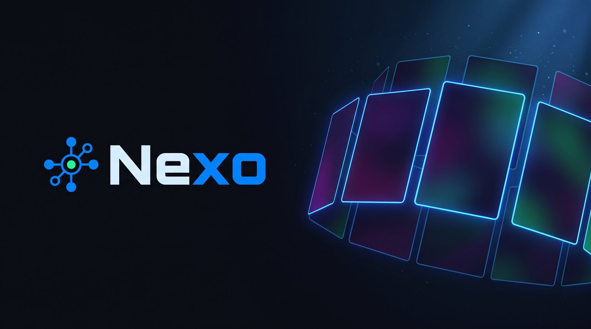
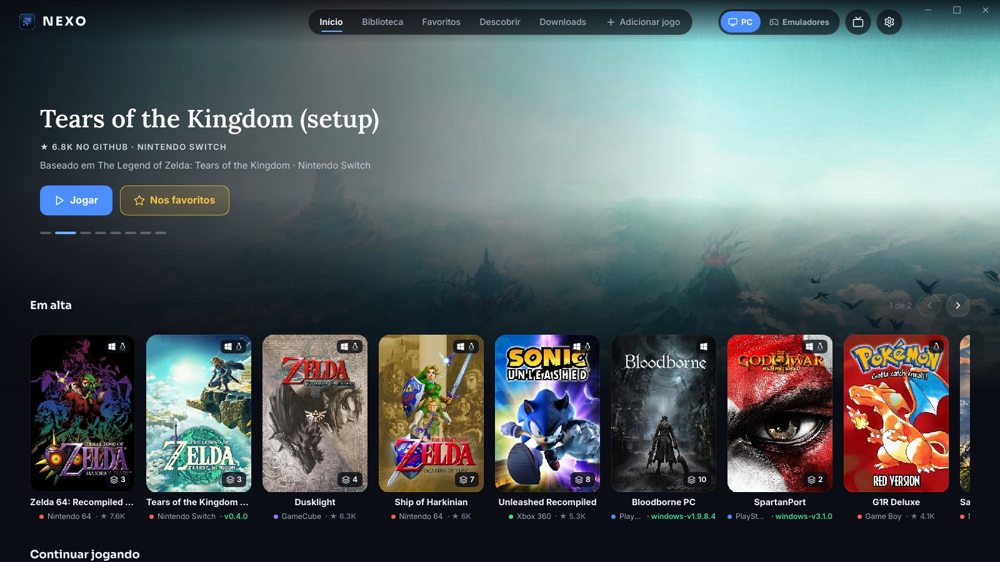
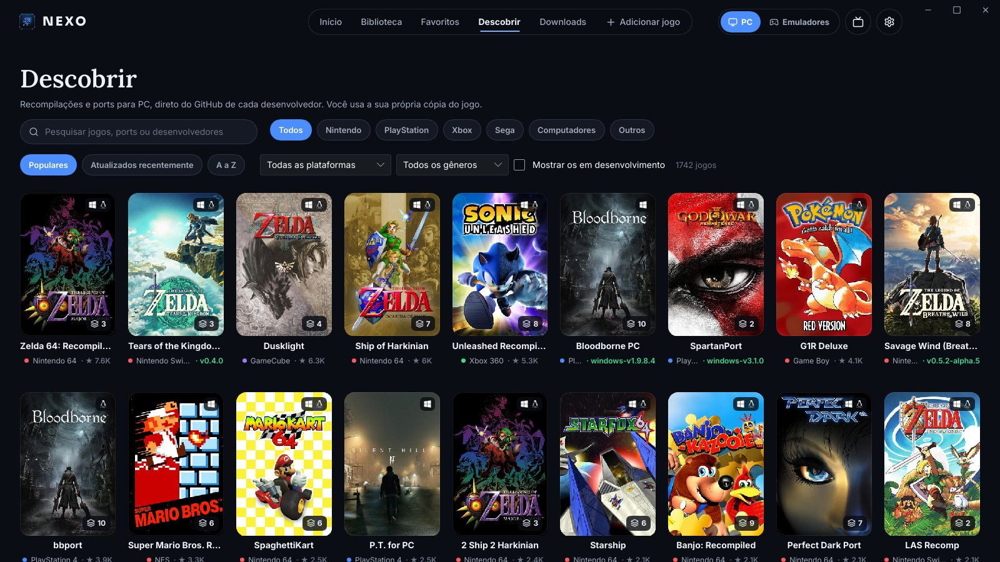
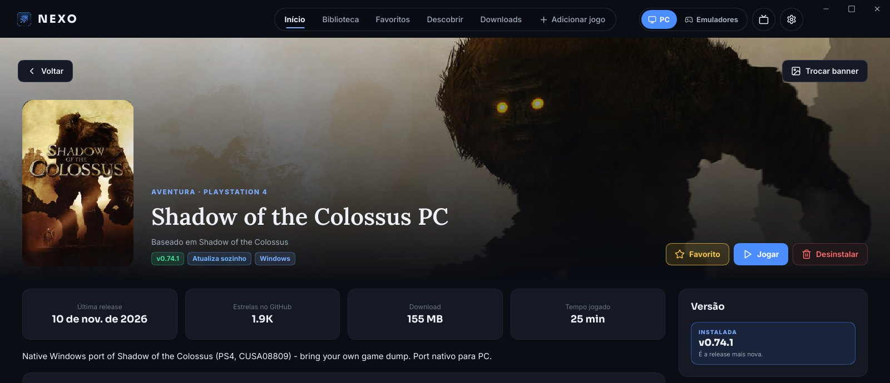
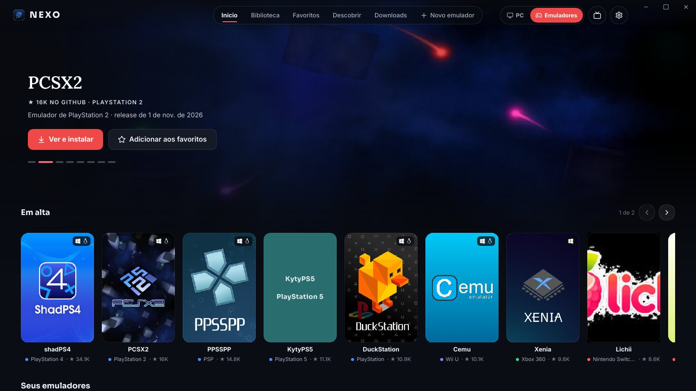
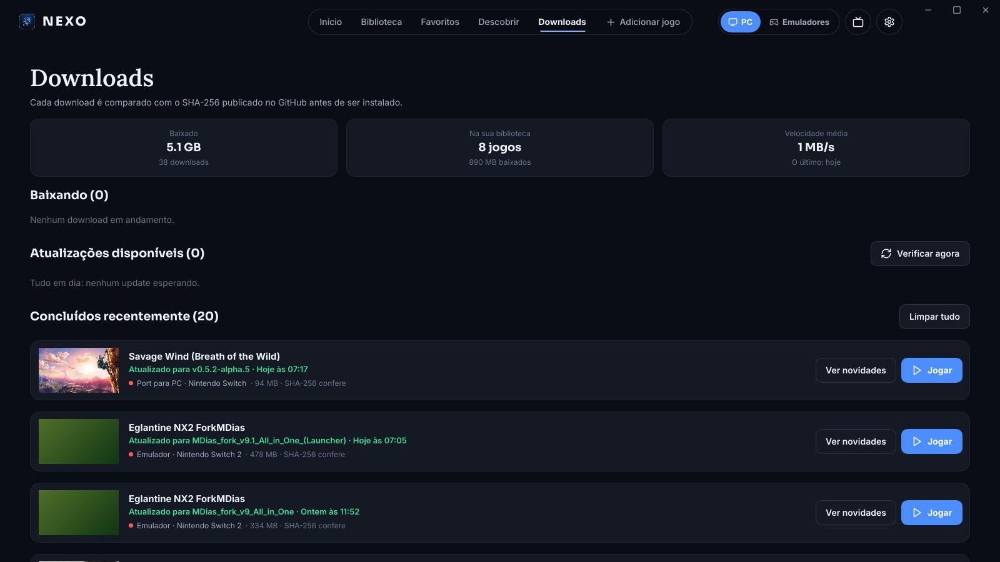
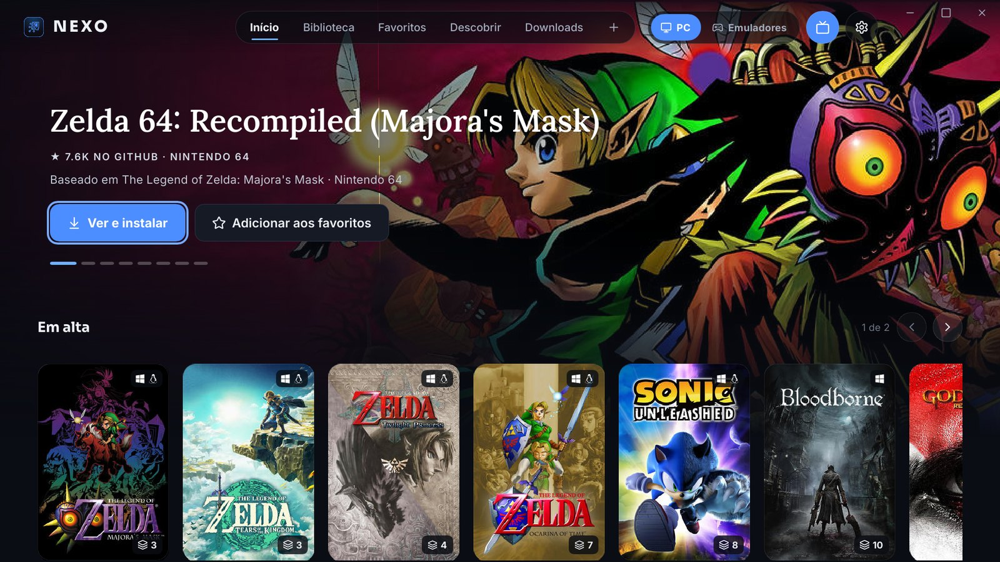

<p align="center">
  
</p>

<p align="center">
  <b>Os recomps, ports e emuladores da comunidade num lugar só.</b><br>
  Descubra, instale, atualize e jogue — direto do GitHub de cada desenvolvedor.
</p>

<p align="center">
  <a href="https://github.com/nexolauncher-glitch/nexo/releases/latest"></a>
  
  <a href="LICENSE"></a>
</p>

<p align="center"><b>Português</b> · <a href="README.en.md">English</a></p>

---



## O que é o Nexo

Nos últimos anos, a comunidade transformou jogos clássicos de console em programas que rodam
**nativos no PC**: as recompilações (*recomps*) e os *ports*. Zelda 64, Sonic Unleashed, Bloodborne,
Tears of the Kingdom e muitos outros. Cada um vive no seu repositório, com o seu jeito de instalar,
atualizar e preparar o jogo.

O **Nexo** junta tudo isso num launcher leve, para Windows e Linux:

- um **catálogo com mais de 1.700 projetos** e mais de 20 emuladores, com capa, banner e estrelas;
- **instala e atualiza com um clique**, baixando sempre da release oficial de quem fez o projeto;
- confere o **SHA-256** de cada arquivo e **nunca apaga os seus saves**;
- tem **modo TV** com controle, para jogar no sofá ou no Steam Deck.

> O Nexo **não traz jogos, chaves, firmware nem BIOS**. Os projetos do catálogo pedem a sua própria
> cópia do jogo; o Nexo só baixa o que o desenvolvedor publicou e organiza para você.

## Funcionalidades

**Descobrir e organizar**
- Dois universos: **PC** (recomps e ports) e **Emuladores**, cada um com Início, Biblioteca,
  Favoritos e Descobrir próprios.
- Busca, filtros por console, plataforma e gênero, e ordenação por populares, recentes ou A a Z.
- Capas e banners automáticos, do [SteamGridDB](https://www.steamgriddb.com), sem configurar nada; ou os seus.
- Adicione qualquer projeto pelo link do GitHub, Codeberg ou outro Forgejo/Gitea.

**Instalar e atualizar com segurança**
- Escolhe sozinho o arquivo certo para o seu sistema; dá para escolher outro.
- Download com retomada e conferência do SHA-256 publicado.
- Cada versão fica na sua pasta. A anterior continua lá até você decidir apagar, e dá para voltar
  ou **fixar** uma versão.
- Saves e arquivos seus são levados para a versão nova; o que um update trocaria vai antes para um
  backup.
- **Receitas automáticas** para projetos que precisam de preparo: o Nexo roda o setup, compila
  shaders e até **monta o jogo a partir dos seus NSP/NSZ do Switch**, sem ferramentas externas.

**Jogar**
- Jogar direto ou pelo launcher do projeto, com o tempo jogado contado.
- **Backup automático dos saves** (antes de cada update e ao desinstalar), com restauração.
- **Adicionar à Steam** com a capa do jogo: o atalho abre pelo Nexo, com versão, Proton e tempo de jogo.
- No Linux, jogos de Windows rodam pelo **Proton, umu-run ou Wine**.

**Aparência e conforto**
- Visual escuro ou claro, em português ou inglês.
- **Modo TV**: tela cheia, tudo maior e navegação completa pelo controle. Liga sozinho no modo jogo
  do Steam Deck, ou com um clique no botão da TV.
- O próprio Nexo se atualiza a partir das releases deste repositório, sempre com a sua permissão, e
  só aceita versões com a assinatura do Nexo.

## Capturas

| Descobrir | Página do jogo |
|---|---|
|  |  |
| **Emuladores** | **Downloads** |
|  |  |

**Modo TV**



## Como instalar

Baixe a versão mais nova em **[Releases](https://github.com/nexolauncher-glitch/nexo/releases/latest)**.

### Windows 10/11 (64 bits)
1. Baixe `nexo-…-windows-x64.zip` e extraia numa pasta sua (por exemplo, `Documentos\Nexo`).
2. Abra o `nexo.exe`.
3. Na primeira vez, o Windows pode mostrar **"O Windows protegeu o computador"**, porque o Nexo ainda
   não tem certificado de assinatura pago. Clique em **Mais informações → Executar assim mesmo**.

### Linux (x64)
1. Baixe `nexo-…-linux-x64.tar.gz` e extraia:
   ```bash
   mkdir -p ~/Nexo && tar -xzf nexo-*-linux-x64.tar.gz -C ~/Nexo
   ```
2. Abra com `~/Nexo/nexo`.
3. Para jogos que só têm versão de Windows, instale o **Proton** (pela Steam) ou o **umu-launcher**.

No Steam Deck e em outros sistemas com o modo jogo da Steam, use **Configurações → Pôr o Nexo na Steam** para abri-lo em modo TV direto do modo jogo.

### Updates
O Nexo procura versões novas ao abrir e de tempos em tempos. Quando sai uma, ele mostra as novidades e
pergunta antes de atualizar. O download vem das releases deste repositório; o Nexo confere a assinatura da versão e o SHA-256 do
pacote antes de trocar qualquer arquivo.

## Perguntas frequentes

**O Nexo é pirataria?** Não. Ele não hospeda nem baixa jogos comerciais. Os projetos do catálogo são
programas livres publicados pelos autores no GitHub, e cada um pede os arquivos do jogo que você já
tem.

**Onde ficam os jogos?** Na pasta que você escolher em **Configurações → Pastas** (por padrão,
`Nexo/Jogos` no seu usuário). Cada jogo tem uma pasta por versão.

**Desinstalar um jogo apaga os meus saves?** Não. O Nexo só apaga os arquivos que ele mesmo instalou, e
mostra antes o que vai sair.

**Achei um projeto que não está no catálogo.** Use **Adicionar jogo** com o link do repositório, ou abra
uma *issue* aqui para ele entrar no catálogo de todo mundo.

## Linha de comando

Junto vem o `nexo-cli`, para scripts e servidores: `nexo-cli ajuda` lista tudo. Os principais são `lista`,
`instalar <id>`, `verificar`, `atualizar`, `jogar <id>` e `remover <id>`.

## Créditos e licença

- Catálogo montado a partir da curadoria do Nexo, do [recomplauncher.com](https://recomplauncher.com) e do
  [recomphub.com](https://recomphub.com); arte do [SteamGridDB](https://www.steamgriddb.com).
- Interface feita com [Slint](https://slint.dev).
- Fontes [Inter](https://rsms.me/inter/), [Sora](https://github.com/sora-xor/sora-font) e
  [Lora](https://github.com/cyrealtype/Lora-Cyrillic) (SIL OFL).
- Ícones [Lucide](https://lucide.dev) (ISC) e [Simple Icons](https://simpleicons.org) (CC0).
- Cada projeto do catálogo pertence a seus autores, e os jogos, às suas empresas.
- As bibliotecas usadas e as licenças delas vão no `TERCEIROS.txt`, dentro de cada pacote.

O Nexo é **grátis e de código fechado**: pode usar e compartilhar o pacote oficial à vontade, sem
modificar e sem vender (veja a [licença](LICENSE)). Novidades de cada versão estão no
**[CHANGELOG](CHANGELOG.md)**.

<p align="center"><a href="https://slint.dev"></a></p>
